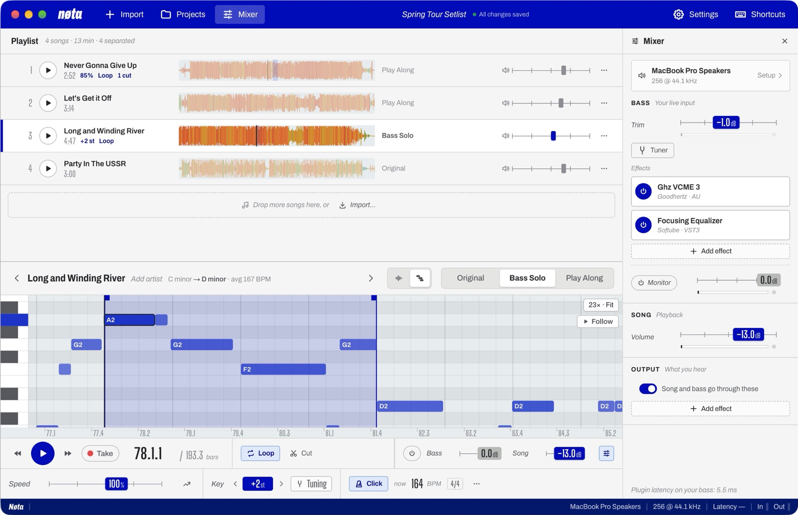
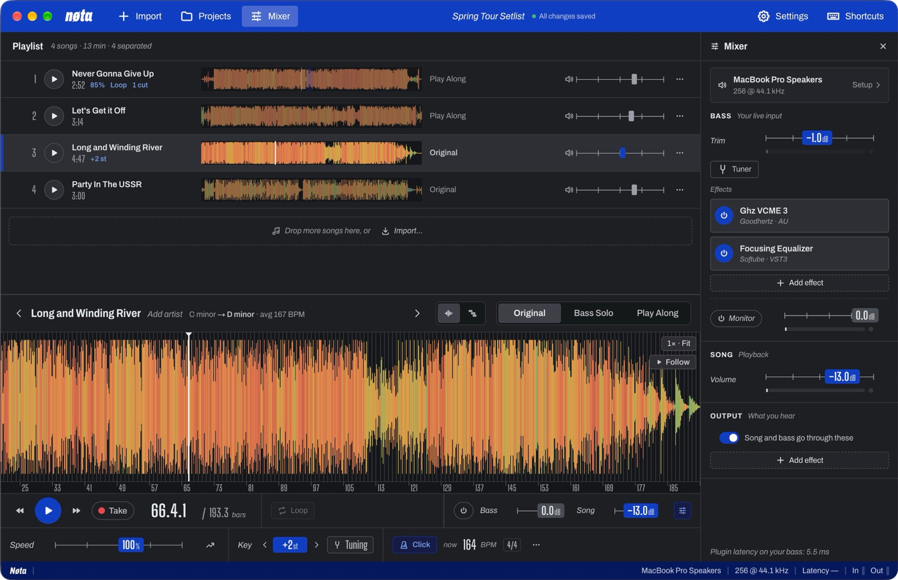

# Nøta

A bass practice app for macOS (Apple Silicon), Windows and Linux. Import the songs you want to learn and Nøta splits each one into an **isolated bass part** (to learn it) and a **backing track without bass** (to play along). Loop and slow down the hard bits, change the key, and play your bass through your own VST3 and Audio Unit plug-ins, all in one window.

**Website:** [antonelmvik.com/nota](https://antonelmvik.com/nota) · **Download:** [latest release](../../releases/latest)



| Mode | What you hear |
| --- | --- |
| **Original** | The untouched recording |
| **Bass Solo** | Only the separated bass part |
| **Play Along** | Drums, vocals and everything else, without the bass |

## Features

- **Stem separation** with Demucs, running on your own computer: on the Apple GPU on a Mac, on an NVIDIA GPU or the CPU on Windows. Nothing is uploaded anywhere.
- **Notes view:** switch the waveform to a piano roll of the bass line, transcribed from the separated bass, with note names on every note. It works in every mode, so you can read the notes while hearing the original or the play-along. When the transcription gets a note wrong, press **E** (or **Edit**) to correct it, as in a DAW's piano roll: click to add a note, drag to move it, drag its end to resize, right-click to delete. Your corrections are saved with the song in the project, and one click goes back to the transcription.
- **Takes:** press ● to record yourself playing along (your clean bass, before its effects). Your notes are then drawn over the song's in the Notes view, lined up with the song even through speed changes and loops. Only the latest take per song is kept, as notes.
- **Loops and slow-down:** Ctrl+drag a loop on the waveform, snapped to the beat. Loops, mode switches and the click are sample-accurate. Speed is 25–150% with the pitch kept. A **speed trainer** raises the speed a step every few loops.
- **Key and tuning:** transpose ±12 semitones and fine-tune ±50 cents, independent of speed, live and instant. **Match A440** lines up recordings that aren't at standard pitch with your bass.
- **Beat grid and metronome:** detected beats and downbeats that follow tempo changes, with a click, count-in, half/double time and tap tempo. The tempo readout follows the playhead.
- **Mixer:** your bass, the song and the output as simple channel strips, top to bottom: the input (one channel for a mono bass, or a pair for a stereo rig) and trim, the built-in tuner, a chain of VST3/AU effects and the Monitor level for your bass; the song's volume; output effects. The interface itself (driver, devices, sample rate, buffer) is set up once in **Settings → Audio**.
- **Practice cuts:** select a part (Ctrl+drag) and press Backspace: playback skips it and the waveform and notes leave it out, as if the song were shorter. Nothing is deleted; restore cuts one by one or all at once. Exports “with your changes” leave them out.
- **Output effects:** a second chain processes the song and, if you like, your bass (the metronome stays out).
- **Undo and redo** (⌘Z, ⇧⌘Z) for every edit except removing songs: speed, key, loops, levels, names, effects, song order.
- **Projects** are self-contained folders, so you can move or back one up in one piece.
- **Light and dark themes**, in three colours.
- **Low latency on Windows** through your interface's ASIO driver.



## Download

Get the latest version from the [Releases](../../releases) page. Nøta is free.

- **Mac** (macOS 13 or later, Apple Silicon): unzip and move **Nøta** to Applications. The app isn't notarised by Apple yet, so macOS says it's "damaged" or can't be verified. To open it, run this once in Terminal:

  ```bash
  xattr -dr com.apple.quarantine /Applications/Nøta.app
  ```

  It removes the "downloaded from the internet" mark that makes macOS block the app. If macOS says it can't verify Nøta (rather than "damaged"), **System Settings → Privacy & Security → Open Anyway** works too.
- **Windows** (10 or 11, 64-bit): run **Nøta Setup**. It installs for your user only, without an administrator password. The installer isn't signed yet, so Windows says "Windows protected your PC" the first time: click **More info**, then **Run anyway**.
- **Linux** (x64; new in 1.1, a preview tested on Debian 13 with GNOME): on Debian or Ubuntu, install the `.deb` with `sudo apt install ./nota_<version>_amd64.deb` (or open it in Software). It also installs `pipewire-jack`, which Nøta uses for low latency. Elsewhere, the AppImage runs on most distributions: make it executable (`chmod +x`) and open it.

**First launch:**
1. Create a project and import a few songs.
2. Nøta offers to **install the audio environment**: Python, PyTorch and the separation models, about 1 GB on disk (a few hundred MB to download). Separation, tempo and key detection and the Notes view run in it, all on your computer.
3. In **Settings → Audio**, choose your audio interface. On Windows, pick **ASIO** as the driver to hear your bass live, and on Linux **JACK**.

Separation takes about a minute per song on an Apple Silicon Mac or with an NVIDIA GPU, and several minutes on a low power laptop's CPU. It runs in the background, and the selected song goes first; the original plays while you wait.

## Using it

Shortcuts below are written for the Mac. On Windows, ⌘ in menu shortcuts is Ctrl, and ⌘ and ⌥ in mouse gestures are Alt.

1. **Import songs** with the Import button in the top bar or ⌘I, or drop audio files onto the window. MP3, WAV, FLAC, AIFF, M4A, OGG and more work. Nøta asks whether to copy the songs into the project or leave them where they are; change that in Settings → Storage. Separation and analysis run in the background, one song at a time, and the selected song goes first.
2. **Pick a mode** per song. Each mode becomes available when its tracks are ready.
3. **Waveform:** colour shows frequency content (warm for bass and kick, cool for treble), with bar and beat lines. Click to move the playhead. **Ctrl+drag** makes a loop; drag its edge handles to adjust it, and double-click to remove it. Positions snap to the beat; hold ⌘ for a free position. Ctrl+scroll or pinch to zoom. Zoomed in, **Follow** (under Fit) keeps the playhead in view while playing, turning the page before it reaches the edge; scrolling yourself pauses it until you next press play. Click the clock to switch between minutes and bars. The deck grows to fill the window while the playlist is short; drag its top edge to set its height yourself (double-click the edge to let it fit again).
   **Notes:** switch to Notes with the icons above the waveform, in any mode. The first time, the separated bass is written out as notes (a few seconds) and saved with the song. The piano roll shows each note's name, follows your key change, and works like the waveform: click or drag to move the playhead, Ctrl+drag to make a loop, sideways scroll to move along. Pinch or Ctrl+scroll zooms in time. Plain scroll moves up and down the keyboard, ⌘+scroll zooms it, and double-clicking the keyboard fits the notes. The time zoom carries over when you switch between Waveform and Notes.
4. **Speed:** drag the slider or click its value and type. `−` / `=` change it by 1% (5% with ⇧), and `0` resets. Presets and the speed trainer are behind the ↗ button.
5. **Key:** `⇧↑` / `⇧↓`, or the key control. The change is instant, and works at any speed.
6. **Metronome:** **Click** or `K`. The ··· menu has the meter, where the bar starts, ½× / 2×, a typed or tapped tempo, and a 1–2 bar count-in.
7. **Bass input:** choose your interface in **Settings → Audio** (on Windows, pick ASIO as the driver to hear your bass live), then the input your bass is plugged into (or a pair, such as 1 + 2, if you play in stereo; also in the **Mixer**), and set the gain on the interface (watch the clip light). Turn on **Monitor** to hear your bass; the deck's quick levels (Monitor, Bass, Song) set the balance without opening the Mixer. Press `T` for the tuner. The round-trip latency is shown in the status bar.
8. **Export:** the song's ⋯ menu exports the original, the bass or the play-along as WAV (24-bit), FLAC or MP3, for use in other software. If the song has speed or key changes or cuts, you choose whether to include them (with changes, cut parts are left out); the audio engine then renders the track offline through the same stretcher as playback (about 30 seconds for a 7-minute song).
9. **Effects:** in the **Mixer**, **Add effect** in the Bass or Output strip (scan for plug-ins the first time). Click an effect to open or close its window; effect windows float over Nøta and hide while you use another app. The power button bypasses an effect. Plug-in settings are saved with the project. The **Bass** chain processes your bass; the **Output** chain processes everything you hear. Turn off **Include my bass** to keep your bass out of the output effects (it then joins the mix after them).

Every slider takes a typed value: click it, type, press Enter. ⌥-click resets it. Right-click a song for its menu. ⌘Z undoes the last edit. The **Shortcuts** button in the top bar lists every shortcut.

| Shortcut | Action |
| --- | --- |
| ⌘Z ⇧⌘Z | Undo / redo |
| Backspace | Cut the selected part out |
| Space | Play / pause |
| 1 2 3 | Original / Bass Solo / Play Along |
| ← → | Skip back / forward (⇧ for 1 s) |
| ↑ ↓ | Previous / next song |
| ⇧↑ ⇧↓ | Key up / down a semitone |
| I O L | Loop start / end / on-off |
| − = 0 | Slower / faster / normal speed |
| K M T | Metronome / monitoring / tuner |
| ⌘I ⌘N ⌘O ⌘P ⌘, | Import / new project / open project / setlist PDF / settings |

## Settings

Mixer, Projects, Settings and Shortcuts share the right-hand pane. Click one in the top bar to switch; × (or Esc, except in the Mixer) closes it. Clicking the audio device in the status bar, or the device line at the top of the Mixer, opens Settings → Audio.

- **Audio:** driver (Windows), interface, input channel, sample rate and buffer size.
- **Appearance:** System, light or dark theme; brand colour (Cobalt, Vermilion or Emerald).
- **Playback:** go back to the start point on stop or stay where it stopped.
- **Waveform:** snap to the beat grid; colour by frequency or a single colour.
- **Tuning:** tuner reference pitch (A = 430–450 Hz).
- **Separation:** standard or high quality (slower); install or reinstall the audio environment.
- **Storage:** open the last project or the start screen when Nøta starts; copy songs into projects, leave them in place, or ask; this project's size; where new projects go.
- **Plugins:** VST3 folders and rescan.
- **Updates:** a daily check for a newer version on GitHub (one anonymous request; Nøta says so in the status bar and opens the release page, nothing is downloaded by itself), or check now.

Per-song settings (speed, key, loops, grid) live on the song. Levels and effects live in the Mixer; the audio interface in Settings → Audio.

## Building from source

Requirements on a Mac: Node 20+, Xcode or the Command Line Tools, and CMake (`brew install cmake`). On Windows: Node 20+, Visual Studio 2022 Build Tools (C++), CMake, Git, and [MSYS2](https://www.msys2.org) for building FFmpeg (`npm run tools:build` lists the packages it needs if they're missing). On Linux, on Debian or Ubuntu: `sudo apt install git build-essential cmake pkg-config nodejs npm nasm libasound2-dev libjack-jackd2-dev libx11-dev libxext-dev libxrandr-dev libxinerama-dev libxcursor-dev libxcomposite-dev libfreetype-dev libfontconfig1-dev`, and `pipewire-jack` for JACK on a PipeWire desktop. FFmpeg and Python don't need to be installed: Nøta builds and bundles its own.

```bash
npm install
npm run engine:build        # the audio engine (JUCE 8.0.4, cloned into native/third_party; the ASIO SDK too on Windows)
npm run tools:build         # an audio-only FFmpeg with LAME, built from source, and uv, into native/build/tools
npm run setup:separation    # optional for development: separation/.venv with Python 3.13, PyTorch and Demucs (~1 GB)
npm run dev                 # development build with hot reload
npm run package             # Mac: dist/mac-arm64/Nøta.app (ad-hoc signed). Windows: dist/Nøta Setup <version>.exe. Linux: dist/Nøta-<version>.AppImage and dist/nota_<version>_amd64.deb
```

On Windows on ARM the same steps build the x64 app. Pushes to `main` build the Windows installer on GitHub Actions (`.github/workflows/windows.yml`), on a clean Windows machine that also checks the engine doesn't need the Visual C++ runtime, and the Linux packages on Ubuntu 22.04 (`.github/workflows/linux.yml`).

Where things go: the audio environment and models in `~/Library/Application Support/Nøta` on a Mac, in `%LOCALAPPDATA%\Nøta` on Windows (settings in `%APPDATA%\Nøta`), in `~/.local/share/Nøta` on Linux (settings in `~/.config/Nøta`). Projects are portable between all three: relative paths are stored with `/`, and Audio Unit effects show as "Mac only" on Windows and Linux and keep their settings.

`npm test` runs the tests (vitest) and `npm run typecheck` checks the types. `tests/engineRender.test.ts` checks song playback sample by sample: `NotaEngine --render <script.json> <out.wav>` runs the engine's song path from a script instead of an audio device and the test compares the output with the source frames (bit-exact playback, loop wraps, mode switches, seeks, resampling, slow-down, key change, the metronome and the count-in; skipped if the engine isn't built). The service tests run real audio through import, separation, validation, saving, reopening and project folders, with only the separation model replaced by a fake.

Environment overrides for development: `NOTA_ENGINE_PATH`, `NOTA_PYTHON`, `NOTA_FFMPEG`, `NOTA_FFPROBE`, `NOTA_SEPARATION_MODEL`, and `NOTA_USER_DATA` (run a second copy with separate settings). `NOTA_OUT=dist-next npm run package` builds into another folder while the app in `dist` is open, and `npm run icon` re-renders the app icon from `build/icon.html`.

### Linux

Linux is new in 1.1, as a preview: tested on Debian 13 with GNOME on x64, built with GCC. The platform-specific parts are kept apart (`JUCE_LINUX` in the engine, `process.platform === 'linux'` in the app). How it works there:

- **Engine:** `npm run engine:build` builds with GCC and passes the playback tests. ALSA and JACK are both offered. ALSA's device list is cut down to one entry per card and device, and names read "System default (PipeWire …)" or "card, device". JACK is the low-latency route: on a PipeWire desktop it needs `pipewire-jack`, which the `.deb` installs; when it's missing, Settings → Audio says so and offers the install command. Under JACK the playhead is timed from JACK's own latency figures (a JUCE patch reads the latency range, which PipeWire fills in). The app puts PipeWire's JACK library first when it starts the engine (Debian keeps it out of the default path), and the JACK buffer menu sets PipeWire's buffer size (`PIPEWIRE_LATENCY`). When PipeWire runs a multichannel interface as surround sound, Settings → Audio says so and offers **Use as audio interface**, which switches it to PipeWire's **Pro Audio** profile. To do it by hand, set the interface to that profile (in pavucontrol, or `wpctl status` for the card's ID, `pw-cli enum-params <id> EnumProfile` for its profiles, then `wpctl set-profile <id> <index>`): its inputs are then numbered in hardware order (Input 1, Input 2 …). In a surround profile PipeWire names them after speakers, in an order that isn't the hardware's, and Nøta shows those names as they are. Linux doesn't say what a device is, so the system default, the sound server and the computer's own sound card are treated as a built-in mic and speakers: their input only opens while something listens, and Monitor asks first.
- **Tools:** `npm run tools:build` builds the same audio-only FFmpeg and LAME with GCC (it needs `nasm` on x64) and fetches uv's Linux release. With them the service tests run too.
- **Window:** on GNOME (Wayland, which Electron uses by itself), the brand bar is the title bar with GNOME's own window buttons over its right end, the hidden menu's shortcuts work, and Alt is free for the app's gestures (GNOME moves windows with Super).
- **Python:** PyPI's Linux PyTorch comes with NVIDIA's CUDA libraries (about 2.5 GB), so on Linux uv installs PyTorch's CPU build (`--torch-backend cpu`, about 200 MB), in `npm run setup:separation` and in the app. Separation on a laptop CPU takes about 1.2× the song's length (four to five minutes for a song). Both `separate.py` and `analyze.py` use an NVIDIA GPU when PyTorch has CUDA, but the app doesn't install a CUDA build yet.
- **Packaging:** `npm run package` builds an AppImage and a `.deb` for x64. The AppImage uses AppImage's static runtime (`toolsets.appimage` in package.json), so it needs FUSE 3, which desktops have, and not the old libfuse2. The `.deb` installs to `/opt/Nøta` with a desktop entry and icons (`build/icons`, made by `npm run icon`), and `desktopName` lets GNOME match the window to it. The engine and FFmpeg need the glibc they were built against (2.38 on Debian 13), so release packages come from the Ubuntu 22.04 job (glibc 2.35).

Still to do: CUDA PyTorch for NVIDIA GPUs, arm64 packages, and testing on more distributions and with real audio interfaces under JACK.

The window and menus already work off the Mac (the brand bar is the title bar, the menu is hidden but keeps its shortcuts, and Alt takes ⌘'s place in gestures; see `src/renderer/platform.ts`).

## How it's built

```
┌──────────── Renderer (React) ─────────────────────┐
│ Playlist · modes · waveform · practice controls   │
│ NativePlayer: sends transport commands, draws the │
│   playhead from the engine's position reports     │
└──────────────▲────────────────────────────────────┘
               │ IPC (typed preload API)
┌──────────────┴────────── Main (Electron) ─────────┐
│ ProjectService   project folder, autosave, import │
│ SeparationQueue  background separation jobs       │──▶ separation/separate.py   (Demucs)
│ AnalysisService  beats, key, tuning               │──▶ separation/analyze.py    (beat_this, librosa)
│ Transcription    bass notes for the Notes view    │──▶ separation/transcribe.py (Basic Pitch)
│ AudioSession     devices, levels, effects chains  │──▶ native/ NotaEngine (JUCE, C++)
│ TransportService song playback, restart recovery  │      song tracks, stretch/key, metronome,
└───────────────────────────────────────────────────┘      input, monitoring, plug-ins, tuner, limiter
```

- **One native engine, one clock.** Browsers can't host plug-ins or monitor with low latency, so `native/` is a small JUCE app running beside Electron, talking JSON over stdin/stdout. It owns the input, trim, plug-in chain, monitor level and tuner, and it also plays the song and the metronome, so your bass, the song and the click share one device and one sample clock. Everything leaving it goes through a −1 dBFS safety limiter. An audio interface's input stays open; a microphone is only opened while Monitor or the tuner needs it. Plug-ins are scanned one per process, so a crashing plug-in can't take Nøta down. If the engine crashes, it restarts with monitoring off and the song paused where it was, and the window says that playback stopped.
- **Song playback in the engine** (`native/Source/SongPlayer.cpp`). Each track (original, bass, backing) is streamed from disk by a background thread into a chunk cache, resampled to the device rate on the way in, ahead of the playhead, around the loop and at the stop point. The audio thread only copies samples that are already there: no disk access, locks or allocation. All tracks play in step and only the selected one is audible, so a mode switch is a 30 ms gain crossfade at the same frame. Loops wrap on the exact frame (with a 5 ms crossfade), seeks crossfade in 10 ms. The engine reports the position about 60 times a second, dated to when that audio is heard, and the window interpolates between reports.
- **Slow-down and key change** use [Signalsmith Stretch](https://github.com/Signalsmith-Audio/signalsmith-stretch) in the engine. At 100 % with no key change the stretcher is bypassed and the files play bit-exact. Changing between bypassed and stretched, or swapping in a new file, crossfades between two independent players, so nothing cuts out. A key change is live and instant: nothing is rendered ahead.
- **The metronome** is rendered in the engine from the beat grid, on the song's own clock, so it stays on the beat through loops, seeks, speed changes and the speed trainer. The count-in starts the song exactly on the next beat.
- **Playback copies:** an MP3 or M4A original gets a FLAC copy made with FFmpeg, the same decoder that feeds separation. Playing that copy keeps the original lined up with the stems to the sample (decoders disagree on MP3 start padding), and formats the engine can't read (WMA, say) play too.
- **Real separation.** The backing track is the sum of the separated drums, vocals and other stems, never a phase-cancelled mix. Output is checked (duration, silence) before a mode is marked ready.
- **Projects are folders** (`Name.nota`): `project.json`, a `Songs/` folder for copied songs, and `Generated/` for separated tracks, waveforms, analysis and notes. Separated tracks and playback copies of MP3/AAC songs are 16-bit FLAC (dithered, CD quality): about half the size of 24-bit, for audio that never had more detail. When a song is already separated in another project, its files are copied over as APFS clones, so nothing is separated twice and no disk space is used twice.

## Known limitations

- **Platforms:** Apple Silicon Macs, 64-bit Windows, and 64-bit Linux as a preview (see [Linux](#linux)). Intel Macs aren't supported (PyTorch no longer builds for them). ASIO on Windows and JACK on Linux have seen little testing with real interfaces.
- **Not signed yet:** the Mac app isn't notarised and the Windows installer isn't code-signed, so both systems ask once before opening them (see [Download](#download)).
- **Separation on the CPU** (Windows without an NVIDIA GPU) takes several minutes per song.
- **Bluetooth headphones:** the input device is only opened while Monitor or the tuner is on, so songs play to Bluetooth headphones in full quality. With a Bluetooth headset's own microphone as the input, turning on Monitor or the tuner switches the headset to call quality (16–24 kHz) for the song too; Nøta says so under the input and suggests another microphone. Bluetooth also adds 150 ms or more, too late to monitor your bass, and buffers below 512 samples are raised to 512 there.
- **Opening a microphone** (Monitor or tuner on/off with a built-in, iPhone or Bluetooth mic as the input) restarts the audio device: the song pauses for about a tenth of a second, faded out and back in. An audio interface's input stays open, so with one Monitor and the tuner switch on instantly.
- **Interface gain:** most interfaces don't let software change their preamp gain. Nøta's Trim is digital and labelled as such.
- **Notes are a transcription, not a score.** They're read from the separated bass by Spotify's Basic Pitch model, decoded as one line through the whole song: chords and double stops come out as their strongest note, very quiet ghost notes and harmonics can be missed, and anything the separation puts in the bass track (a synth doubling the bass an octave down, say) is read as bass. Slides and hammer-ons show as the notes they move between.
- **Beat detection** sometimes picks half or double the felt tempo; use ½× / 2× in the metronome menu.


## Design

Nøta's look started out as a close copy of [Goodhertz](https://goodhertz.com)'s plug-ins. I use them for almost everything and love their design language. It has moved on since: a brand-coloured app bar across the top in place of the title bar, a choice of brand colours (Cobalt, Vermilion, Emerald), a dark theme, and the Notes view. Some of the inspiration is still easy to see :)

If you like that style, go and look at the real thing. Goodhertz makes some of the best-sounding and best-looking audio plug-ins around.

## Licence

Copyright © 2026 Anton Elmvik.

Nøta is free software: you can redistribute it and/or modify it under the terms of the [GNU Affero General Public License](LICENSE) as published by the Free Software Foundation, either version 3 of the License, or (at your option) any later version. It is distributed in the hope that it will be useful, but without any warranty; see the licence for details.

Nøta is built on JUCE and other software with their own licences. See [THIRD_PARTY_NOTICES.md](THIRD_PARTY_NOTICES.md).
